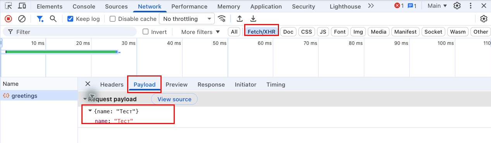
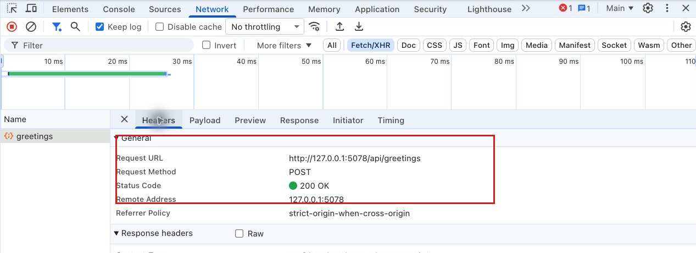

# Міст 2. HTML → DOM → fetch → DevTools

**Статус:** підготовка за потреби; обов’язкова, якщо самоперевірка показала прогалину; не оцінюється  
**Коли опрацьовувати:** після встановлення інструментів і отримання ZIP, до запуску повного стенда; потребу визначайте самостійно за таблицею нижче  
**Орієнтовний час:** 12–18 хвилин читання і 35–55 хвилин практики  
**Перевірений тег стартового репозиторію:** `starter-v0.1.0` (commit `4aa18b3`)

## Навіщо потрібен цей міст

У лабораторних роботах ви одержите готовий мінімальний клієнт у браузері. Вам не
потрібно професійно проєктувати клієнтський інтерфейс або знати JavaScript
напам’ять. Однак потрібно розуміти, де виконується наданий обробник, як він
формує HTTP-запит, де побачити фактичний обмін із API та як безпечно показати
текстову відповідь.

Цей міст є підготовкою, а не окремою «нульовою» лабораторною роботою. Він не
оцінюється, не замінює самостійну роботу й не є умовою допуску до лекцій 1–3.
Перевірте готовність самостійно за таблицею нижче. Якщо хоча б одну дію не можете відтворити без підказки, виконайте міст повністю до основного маршруту. Очікувати позначки викладача не потрібно.

Для практики використовуйте незалежний локальний приклад
[`bridge-browser-fetch-dom`](../../one-time-examples/bridge-browser-fetch-dom/README.md).
Він не містить бази даних, оцінюваного flow baseline 2-A або готового фрагмента ЛР 1.

## Ознаки готовності до роботи

Готовність означає спостережувану дію, а не лише впізнавання назви.

| Що перевіряється | Де це опрацьовано | Спостережуваний результат |
|---|---|---|
| Назвати method у незнайомому записі HTTP-обміну | «HTTP очима клієнта» | Ви правильно знаходите method |
| Назвати URL у незнайомому записі HTTP-обміну | «HTTP очима клієнта» | Ви правильно знаходите URL |
| Знайти request body та відрізнити його від query parameters | «HTTP очима клієнта», «Network як джерело доказу» | Ви показуєте, де дані розміщено в URL, а де — у request body |
| Назвати status code і пояснити його клас | «HTTP очима клієнта» | Ви розрізняєте `2xx`, `4xx` і `5xx` |
| Знайти response body та відрізнити його від headers | «HTTP очима клієнта», «Network як джерело доказу» | Ви показуєте дані, що надійшли від API |
| Надіслати форму через готовий `fetch` | «Сторінка, DOM і подія», «Як читати готовий fetch» та приклад | Браузер фактично надсилає HTTP-запит |
| Знайти HTTP-запит і HTTP-відповідь у DevTools Network | «Network як джерело доказу» | Ви відкриваєте один запис і читаєте обидва напрями обміну |
| Змінити один виведений текст через `textContent` | «Текстова відповідь у DOM» | Після оновлення сторінки видно новий підпис |

## Перевірений приклад

Приклад запускається окремо від стартового репозиторію і не потребує Docker або
бази даних. Для нього потрібна остання стабільна .NET 10 SDK; власний `global.json` прикладу використовує нижню межу `10.0.100`, `latestFeature` і `allowPrerelease: false`. Якщо в `global.json` прикладу вказано `10.0.302`, оновіть об’єкт `sdk`, як пояснено в README цього мосту; якщо інструментарій C# ще не встановлено, спершу
опрацюйте [міст C++ → C#, розділ 9 методички](cpp-to-csharp.md). Відкрийте термінал у корені розпакованого `lab-01-starter.zip`, де поряд лежать `starter-project/` і `one-time-examples/`. Якщо ви перебуваєте у starter з цього ZIP, спочатку виконайте `cd ..`; для клону відкрийте окремий термінал у ZIP. Виконайте:

```bash
cd one-time-examples/bridge-browser-fetch-dom
dotnet restore
dotnet build --no-restore
dotnet run --no-build --urls http://127.0.0.1:5078
```

Потім відкрийте
`http://127.0.0.1:5078/`. Якщо порт `5078` зайнятий, задайте інший у
`--urls` і використовуйте цей фактичний номер порту в усіх подальших адресах.
Ті самі три команди `dotnet` виконують у macOS, Linux і Windows. Передумови,
точні команди й необов’язкові незалежні виклики API наведено в
[`README.md`](../../one-time-examples/bridge-browser-fetch-dom/README.md).

## Сторінка, DOM і подія

HTML описує початкову структуру сторінки. Після читання HTML браузер будує
**об’єктну модель документа (Document Object Model, DOM)** — представлення
документа як об’єктів, з якими може працювати JavaScript. Окремий елемент у
цьому представленні називають **вузлом DOM**. Наприклад, на навчальній сторінці
є `<form>`, `<input>`, `<button>`, абзац для результату та список історії.

Виклик `document.querySelector("#greeting-form")` знаходить вузол за
CSS-селектором і повертає посилання на нього. Код не запускається «всередині
HTML» і не працює постійно. У `index.html` атрибут `defer` наказує браузеру
виконати `app.js` після завершення розбору HTML, коли потрібні вузли DOM уже
побудовано. Без `defer` верхньорівневі виклики `querySelector` у цьому скрипті
виконалися б до появи розміщених нижче елементів і повернули б `null`.

Після виконання верхньорівневого коду обробник, переданий у
`addEventListener`, чекає на конкретну **подію (event)**.

```javascript
form.addEventListener("submit", async (event) => {
  event.preventDefault();
  // Підготовка й надсилання HTTP-запиту.
});
```

Подія `submit` належить формі, тому обробник спрацьовує як після натискання
кнопки, так і після стандартного підтвердження форми з клавіатури. Для валідної
форми `event.preventDefault()` скасовує стандартне надсилання. Без нього браузер
виконав би `GET` до поточної адреси, замінив параметри після `?` даними форми й
перезавантажив документ. Скасування дає обробнику змогу самому виконати `fetch`
і оновити лише потрібні вузли DOM. Така дія не є засобом контролю доступу:
користувач контролює браузер і може надіслати запит іншим клієнтом.

### Чому це потрібно

У кожній лабораторній роботі взаємодія починається з готової сторінки. Якщо не
зрозуміло, який вузол знайдено, яка подія сталася і коли викликано обробник,
неможливо надійно зіставити дію користувача із запитом у Network. Водночас цей
міст не навчає верстати інтерфейс: HTML, CSS і JavaScript тут є інструментами
спостереження за системою.

## HTTP очима клієнта

**HTTP-запит (request)** описує те, що клієнт надсилає серверу:

- **method** визначає вид операції, наприклад `GET` або `POST`;
- **URL** визначає адресу ресурсу або кінцевої точки API (endpoint);
- **headers** передають службові відомості, наприклад формат тіла;
- необов’язковий **body** містить дані запиту.

У URL після `?` можуть бути **параметри запиту в URL (query parameters)**,
наприклад `/api/items?state=open`. Вони є частиною URL, а не `request body`.
Один URL може підтримувати різні methods, тому для пошуку endpoint завжди
потрібна пара `method + URL`.

**HTTP-відповідь (response)** рухається у зворотному напрямку. Вона містить
**status code**, headers і body. Клас `2xx` повідомляє, що сервер успішно
опрацював запит; `4xx` — що запит клієнта не може бути виконаний у такому
вигляді; `5xx` — що сервер не зміг коректно завершити опрацювання. Конкретний
код стану має точнішу семантику, яку ви опрацьовуватимете далі.

Той самий обмін, який далі буде видно в Network, у текстовому вигляді може
мати такий запис:

```http
POST /api/greetings HTTP/1.1
Host: 127.0.0.1:5078
Content-Type: application/json

{"name":"Олена"}

HTTP/1.1 200 OK
Content-Type: application/json; charset=utf-8

{"message":"Вітаємо, Олена!"}
```

У першому рядку запиту `POST` є method, а `/api/greetings` — шлях у URL;
разом із `Host` він визначає адресу
`http://127.0.0.1:5078/api/greetings`. Порожній рядок відділяє headers від
body. У першому рядку відповіді `200` є status code, а її JSON після headers
— response body. У Network ті самі поля розкладено по підписаних секціях.

Код стану `200` не є синонімом правильності й безпечності всієї системи. Він
описує результат конкретного обміну за правилами цього endpoint, але сам не
доводить, що сервер перевірив усі бізнес-правила або права користувача.

**JSON** — це текстовий формат представлення структурованих даних. Він не є
протоколом, базою даних або автоматичною гарантією правильності. Заголовок
`Content-Type: application/json` повідомляє, як інтерпретувати тіло.

### Чому це потрібно

Method, URL, headers, body і status code утворюють спільну мову всього курсу.
Без неї не можна точно сказати, що браузер надіслав, що API повернув і який
саме результат ви спостерігали. Вислів «запит спрацював» занадто нечіткий для
відтворюваної перевірки.

## Як читати готовий fetch

У прикладі HTTP-запит створює такий фрагмент:

```javascript
const response = await fetch("/api/greetings", {
  method: "POST",
  headers: {
    "Content-Type": "application/json"
  },
  body: JSON.stringify({ name: nameInput.value })
});
```

Перший аргумент задає URL. Об’єкт другого аргументу задає method, headers і
body. `JSON.stringify` перетворює JavaScript-об’єкт на текст JSON для
`request body`. Значення походить із поля `nameInput`, але на стороні API воно
все одно є клієнтськими даними, а не перевіреним фактом.

`fetch` повертає **об’єкт очікуваного результату (Promise)**, що представляє
майбутнє завершення асинхронної операції. `await` призупиняє поточний
асинхронний обробник до надходження відповіді, не перетворюючи мережеву операцію
на миттєву. Потім `await response.json()` читає `response body` та перетворює
JSON на JavaScript-значення. Важлива деталь: одержання відповіді й читання її
тіла — дві окремі асинхронні дії.

### Чому це потрібно

Вам не потрібно писати `fetch` з нуля. Потрібно вміти знайти в готовому виклику
method, URL, headers і body, а потім зіставити їх із фактичним записом Network.

## Network як джерело доказу

Запустіть приклад за його README. Відкрийте DevTools клавішею `F12` або
поєднанням `Ctrl+Shift+I` у Windows і Linux, `Cmd+Option+I` у macOS чи через
меню інструментів розробника. У Safari спершу ввімкніть функції для
веброзробників у параметрах Safari. Перейдіть на вкладку Network **до**
надсилання форми. Розташування кнопок може відрізнятися між версіями, тому
орієнтуйтеся на призначення панелі, а не на координати зі знімка екрана.

Не переходьте одразу до читання всього JavaScript-файла. Спочатку спостерігайте
обмін у Network, а тоді зіставте його поля з коротким фрагментом `fetch`. Так код
відповідає на вже поставлене практичне запитання.

1. Очистіть попередні записи, якщо вони заважають.
2. В адресному рядку відкрийте `http://127.0.0.1:5078/?demo=1`, використавши
   фактичний номер порту застосунку. У Network
   знайдіть запис із URL сторінки й типом `Document`, `Doc` або `HTML` — назва
   залежить від браузера. `demo=1` видно в URL і серед `query parameters`, а
   `request body` у цього запиту немає.
3. Уведіть звичайне ім’я та надішліть форму. Знайдіть запис `greetings`; за
   потреби використайте фільтр `Fetch/XHR` у Chrome або Edge чи `XHR` у Firefox.
   Цей фільтр приховує запис документа, тому перед повторенням кроку 2 його
   потрібно вимкнути.
4. На боці запиту знайдіть method `POST`, повний URL, request headers і JSON у
   `request body`. Переконайтеся, що параметрів після `?` у цьому URL немає.

Див. рис. 13.



Рис. 13. Міст HTML → DOM → fetch: фільтр Fetch/XHR, запис greetings і Request payload з JSON name: Тест.

Див. рис. 14.



Рис. 14. Той самий greetings у Headers: POST, 200 OK, application/json. Міст працює окремо на 127.0.0.1:5078, без БД; це не порт основного SecureLab API.


5. На боці відповіді знайдіть status code, response headers і JSON у
   `response body`. Поверніться до `fetch` у `app.js` і зіставте поля один до
   одного.
6. Очистіть поле і натисніть «Надіслати». Одразу після натискання подивіться
   на поле: браузерна перевірка атрибута `required` спрацює до події `submit`
   і покаже власну підказку. Після цього перевірте Network: попередній
   результат на сторінці не зміниться, а нового запису `POST` не буде. Текст
   підказки залежить від мови браузера.
7. Уведіть один пробіл і повторіть дію. `required` вважає непорожнім навіть таке
   значення, тому HTTP-запит буде надіслано. У Network видно відповідь зі
   `status code` `400`, а сторінка показує `Помилка 400: Уведіть ім’я.`

Той самий endpoint можна необов’язково викликати з термінала командою з README:
виклик відбувається без сторінки й без форми, а API повертає ту саму відповідь
для звичайного імені.

Атрибут `required` визначає, за яких умов ця форма дійде до надсилання, а не
те, які дані може одержати API. Де розмістити перший надійний
механізм контролю, визначатимемо в лекції 1.

Network показує дані, що перетнули мережеву межу: запит від браузера і відповідь
від API. Він не показує ні перевірок у серверному коді C#, ні SQL-запиту, ні
того, чи було перевірено право доступу. Для цього пізніше знадобляться код,
журнали й тести.
Отже, знімок Network є доказом обміну, але не автоматичним доказом усієї
серверної логіки.

### Чому це потрібно

DevTools Network є головним інструментом спостереження за клієнтською частиною
курсу. У звітах лабораторних робіт потрібні реальні HTTP-запит і
HTTP-відповідь, а не лише знімок редактора чи твердження, що кнопка «працює».

## Текстова відповідь у DOM

Для одного текстового значення приклад використовує `textContent`:

```javascript
function showGreeting(message) {
  // Крок B4: змініть лише підпис перед значенням message.
  result.textContent = `Відповідь API: ${message}`;
}
```

Браузер вирішує, що означає рядок, за місцем, куди його передали. Значення,
передане як текст через `textContent`, залишається текстом. Якщо `message`
містить символи `<b>`, сторінка покаже саме ці символи, а не створить із них
новий елемент.

Коли потрібно побудувати короткий список, приклад явно створює вузол і також
записує його текст:

```javascript
const item = document.createElement("li");
item.textContent = message;
historyList.append(item);
```

У браузері є й інші способи передавати рядок до документа, і вони можуть мати
іншу інтерпретацію. У цьому мосту правилом за замовчуванням є `textContent` для
тексту та `createElement` із `append` для структури. Механізм небезпечної
інтерпретації даних системно розглядатиметься в окремому матеріалі перед ЛР 5.

### Практична зміна B4

У `wwwroot/app.js` знайдіть функцію `showGreeting` та замініть лише підпис
`Відповідь API:` на `Перевірено у браузері:`. Оновіть сторінку, повторно
надішліть форму і покажіть новий текст. Не змінюйте спосіб передавання
`message`: результат має й надалі встановлюватися через `textContent`.

Якщо новий підпис не з’явився, браузер міг використати кешовану версію
`app.js`. Виконайте примусове перезавантаження сторінки або тимчасово вимкніть
кеш у вже відкритій панелі Network, а потім повторіть дію.

Після цього введіть ім’я `<b>Олена</b>` і надішліть форму. Сторінка має показати
символи `<b>` як звичайний текст, а не зробити ім’я жирним. Це спостереження
підтверджує: значення передано текстовій властивості, тому браузер трактує його
як текст.

### Чому це потрібно

Дані відповіді мають стати видимими для користувача, але операція відображення
визначає їхнє значення для браузера. Звичка одразу використовувати текстову
операцію для текстового значення створює коректну основу для ЛР 1 і подальшого
аналізу клієнтського коду в браузері.


## JavaScript, який ви зустрінете у `Client/app.js` starter

У прикладі мосту запит надсилає сам обробник. У starter усі запити проходять через одну допоміжну функцію. Прочитайте її з коментарями. Готовий [api-fetch.js](../../copyable/api-fetch.js) містить цю функцію для читання й точного копіювання; вона вже існує в `Client/app.js`, тому повторно додавати її до starter не треба:

```javascript
// options = {} застосовується, якщо аргумент не передано.
async function apiFetch(path, options = {}) {
  const response = await fetch(path, {
    // ... копіює поля іншого об’єкта.
    headers: {
      Accept: "application/json",
      ...options.headers,
    },
    ...options,
  });

  // ok дорівнює true для кодів 200–299.
  if (!response.ok) {
    // JSON помилки; для іншого формату — null.
    const problem = await response.json().catch(() => null);
    // Виняток обробить catch того, хто викликав apiFetch.
    throw new Error(problem?.title ?? `HTTP ${response.status}`);
  }

  // Читаємо JSON успішної відповіді.
  return response.json();
}
```

Головне: сам `fetch` не вважає відповіді `404` чи `500` помилкою — його Promise відхиляється при мережевій помилці, блокуванні CORS або скасуванні запиту. `apiFetch` перетворює кожну неуспішну відповідь на виняток із текстом поля `title`. Тому код, який її викликає, має просту форму:

```javascript
try {
  const data = await apiFetch("/api/…");
  // показати data
} catch (error) {
  // показати повідомлення про помилку
}
```

Скорочений словник синтаксису для програміста на C++:

| Запис | Значення |
|---|---|
| `const x = …;` | змінна, якій не можна присвоїти нове значення; `let x` — можна |
| `` `Знайдено: ${n}` `` | рядок у зворотних лапках підставляє значення виразу з `${…}`. У звичайних лапках `'…'` чи `"…"` підстановки немає: буде надруковано буквально `${n}` |
| `(event) => { … }`, `() => f(x)` | стрілкова функція; відповідає лямбді `[&](auto event) { … }` |
| `async function f() { … await g(); … }` | те саме призначення, що `async`/`await` у C# |
| `for (const item of items) { … }` | цикл по елементах масиву, як `for (const auto& item : items)` |
| `a === b` | порівняння без перетворення типів; у JavaScript використовуйте його замість `==` |
| `a?.b`, `a ?? b` | як у C#: доступ, безпечний до `null`; запасне значення |
| `obj.title` | поле об’єкта з JSON. Назви — з малої літери, як у відповіді API. Помилка в назві не зупиняє програму: значенням буде `undefined`, і саме це слово з’явиться на сторінці |
| `document.querySelector("#list")` | елемент з `id="list"` або `null`, якщо такого `id` немає |
| `element.replaceChildren()` | прибирає всі вкладені вузли. Викликайте перед повторним заповненням списку, інакше кожне натискання додаватиме ті самі рядки ще раз |
| `button.addEventListener("click", f)` | назва функції без дужок: браузер сам викличе її під час натискання |

Код верхнього рівня в `app.js` виконується один раз після завантаження сторінки (`defer` у `index.html`). Тому пошук елементів і `addEventListener` пишуть на верхньому рівні, а дії — усередині функцій.

Якщо після вашої зміни сторінка поводиться дивно, відкрийте в DevTools вкладку **Console**. Помилки JavaScript показано там червоними рядками з назвою файла й номером рядка; сама сторінка про них не повідомляє.

## Типові хибні уявлення

| Хибне уявлення | Що відбувається насправді |
|---|---|
| «Браузер створив запит, отже його структура надійна» | Користувач контролює клієнт і може надіслати інший запит без цієї форми. |
| «`200` означає, що операція правильна й безпечна» | Код стану описує результат конкретного HTTP-обміну, але не доводить повноту серверних перевірок. |
| «`required`, `<input disabled>` або прихована `<button>` обмежують те, що може одержати API» | Ці засоби визначають поведінку конкретного інтерфейсу. Інший клієнт може сформувати запит без його обмежень. |
| «DevTools показує, що саме сервер перевірив» | Network показує лише те, що було надіслано та одержано через мережу. |
| «Показати рядок на сторінці — завжди однакова операція» | Спосіб передавання рядка визначає, чи браузер трактує його як текст або інакше. |

## Що залишається на лабораторну роботу та лекції

У ЛР 1 ви запустите повний стартовий проєкт, простежите шлях
`browser → API → PostgreSQL → response → DOM`, знайдете endpoint за method і
URL, виконаєте власну обмежену зміну, перевірите порожній та помилковий
сценарії й підготуєте докази. Не копіюйте навчальний endpoint `greetings` або
його форму як виконану частину завдання baseline 2-A.

Лекція 1 формує повну модель системи, пропонує передбачити наслідок запиту,
зміненого поза UI, та локалізує перший надійний серверний механізм контролю.
Поза межами цього мосту також лишаються професійна HTML/CSS-розробка, написання
`fetch` з нуля, каталоги HTTP-методів і заголовків, усталені схеми обробки
помилок, редагування й повторне надсилання запиту, throttling, Performance
panel, caching, HTTP/2 та HTTP/3.

## Запитання для самоперевірки

1. Які частини запису власного HTTP-обміну надіслав браузер, а які повернув API?
2. Уявіть відповідь іншої кінцевої точки API: status `200`, а в body — порожній
   список. Що це повідомляє, а чого не доводить?
3. Значення показано через `textContent`. Що буде видно, якщо воно містить
   символи `<b>`, і чому?

### Відповіді для самоперевірки

1. Браузер надіслав method, URL, request headers і request body; API повернув
   status code, response headers і response body.
2. `200` повідомляє, що endpoint опрацював конкретний запит як успішний, а
   body містить порожній список. Це не доводить правильність усіх бізнес-правил,
   повноту перевірки даних або наявність належного контролю доступу.
3. Сторінка покаже символи `<b>` як звичайний текст, тому що значення передано
   текстовій властивості `textContent`, а не операції побудови структури.


